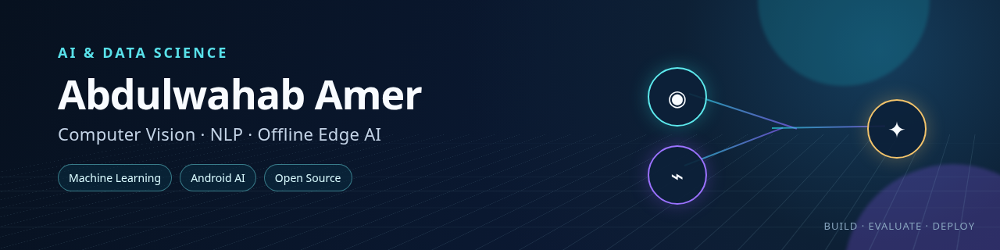

  

# Hi, I'm Abdulwahab Amer 👋

I am an **AI & Data Science student** focused on transforming machine-learning ideas into practical and reproducible software.

My work combines **Computer Vision, Natural Language Processing, Deep Learning, Android development, and Offline Edge AI** to build applications that remain useful even in environments with limited connectivity.

## What I work on 🧠

- End-to-end Computer Vision systems using YOLO, OpenCV, and OCR
- NLP and sentiment-analysis pipelines using classical ML and Transformers
- Offline Android AI applications using Kotlin, CameraX, and LiteRT/TFLite
- Reproducible experiments, benchmarking, evaluation, and educational tools

## Featured work 🚀

- [Hieroglyph OCR](https://github.com/abdulwahabamernew-art/hieroglyph-ocr) — Egyptian hieroglyph detection and Gardiner-code recognition using YOLO and TrOCR.
- [VisionStudio](https://github.com/abdulwahabamernew-art/VisionStudio-Android-ImageProcessing) — Offline Android computer-vision and image-processing suite.
- [Sentiment140](https://github.com/abdulwahabamernew-art/Sentiment140-Data-Mining-Project) — Reproducible sentiment-analysis benchmark with TF-IDF models and DistilBERT.
- [Plant Disease Project](https://github.com/abdulwahabamernew-art/Plant_Disease_Project) — Plant detection and 38-class disease-classification pipeline.
- [Algorithm Battle Arena](https://github.com/abdulwahabamernew-art/Algorithm_Battle_Arena) — Interactive algorithm visualization, benchmarking, and pathfinding laboratory.

## Current focus 🎯

- Improving model evaluation and reproducibility
- Deploying AI models on resource-constrained devices
- Building offline-first applications for real-world use
- Strengthening my skills in Machine Learning and Deep Learning

## Explore my work 🔎

Most of my projects include documentation, experiments, tests, and practical deployment paths. Feel free to explore the repositories, try the available demos, and follow my progress in AI and Data Science.

## التقنية والاهتمامات 🌐

مرحباً، أنا **عبدالوهاب عامر**، طالب في تخصص الذكاء الاصطناعي وعلوم البيانات.

أستخدم البرمجة والذكاء الاصطناعي لبناء مشاريع عملية في **Computer Vision وNLP وMachine Learning وOffline Edge AI**. أهتم بتحويل النماذج والتجارب الأكاديمية إلى تطبيقات يمكن تشغيلها واستخدامها في العالم الحقيقي، خصوصاً في البيئات ذات الاتصال المحدود بالإنترنت.

## Connect 🤝

- GitHub: [@abdulwahabamernew-art](https://github.com/abdulwahabamernew-art)
- Hugging Face: [Bin-Amer](https://huggingface.co/Bin-Amer)
